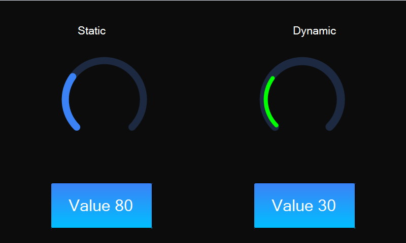
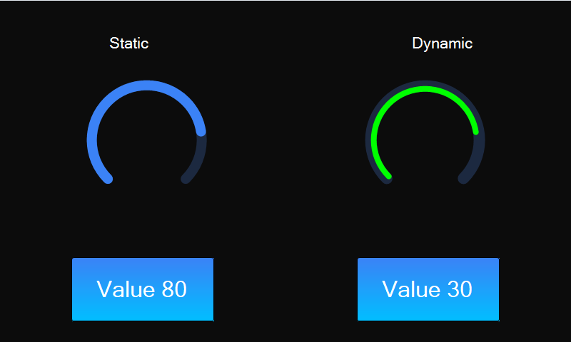

# Arc Value Set Özelliği

Arc (dairesel gösterge) değerini yazılım ile set etmek için kullanılır.

```
ArcSet("Arc1" ,"Value" , "80"); // Arc1 dolumunu %80 yapar.

ArcSet("Arc2" ,"Value" , "30"); // Arc2 dolumunu %30 yapar.
```

Arc nesnesi, arkada sabit bir **track (zemin yayı)** ve önde değere göre dolan bir
**value yayı** olmak üzere iki katmandan oluşur. `Value`, `MinValue` ve `MaxValue`
değerlerine göre value yayının doluluk oranı hesaplanır.

Statik ve dinamik olmak üzere iki farklı Arc Value Set durumu üzerinde etkili olan
faktörler incelenmiştir. Statik Arc lar her sayfadan tüm özelliklerine ulaşılıp
değiştirilebilen nesnelerdir. Static(false) yani dinamik Arc lar ise sayfaya özgüdür.
Sayfa değiştiği zaman hiçbir özelliği tutulmaz. Sayfa değişip tekrar aynı sayfaya
gidildiği zaman Arc ilk hali ile baştan meydana getirilir.

## 📌 1. Arc Tanımı
- **🟢 Statik Arc**: Static özelliği true olan Arc dır. Value Set özelliği **hem aynı sayfadan hem de diğer sayfalardan** değiştirilebilir.
- **🔵 Dinamik Arc**: Static özelliği false olan Arc dır. Value Set özelliği **yalnızca aynı sayfada** değiştirilebilir, diğer sayfalardan değiştirilemez.

## 🎛️ 2. Arc Özellikleri
Arc nesnesinin `ArcSet` / `ArcGet` ile ayarlanabilen belli başlı özellikleri:

| Özellik | Açıklama |
|---|---|
| `Value` | Gösterilen değer (MinValue–MaxValue arası) |
| `MinValue` / `MaxValue` | Değer aralığı |
| `StartAngle` / `SweepAngle` | Yayın başlangıç açısı ve toplam açı genişliği (derece) |
| `TrackColor` / `TrackWidth` | Zemin yayının rengi ve kalınlığı |
| `TrackVisible` | Zemin yayının görünürlüğü (0/1) |
| `ValueColor` / `ValueWidth` | Değer yayının rengi ve kalınlığı |
| `ValueAlign` | Değer yayının hizası: `Inner` / `Center` / `Outer` |
| `RoundedEnds` | Yay uçlarının yuvarlatılması (0/1) |
| `Visible` / `Active` / `Left` / `Top` | Ortak özellikler |

## 🔍 3. Örnek Senaryo
Bu örnekte sol tarafta **statik** (mavi, Center hizalı), sağ tarafta **dinamik**
(yeşil, Inner hizalı — kenarlık efekti) iki Arc bulunur. Alttaki iki buton her iki
Arc ın değerini `ArcSet` ile 80 ve 30 arasında değiştirir.

- `Value 80` butonu: `ArcSet("Arc1","Value","80")` + `ArcSet("Arc2","Value","80")`
- `Value 30` butonu: `ArcSet("Arc1","Value","30")` + `ArcSet("Arc2","Value","30")`

## 🎯 4. Sonuç
✔️ `Value` değeri değiştikçe Arc dolumu anında güncellenir.
✔️ **Statik Arc Value Set** diğer sayfalardan değiştirilebilir.
✔️ **Dinamik Arc Value Set** yalnızca oluşturulduğu sayfada değiştirilebilir.

### Başlangıç durumu (Value 30)



### Value 80 butonuna basıldıktan sonra


